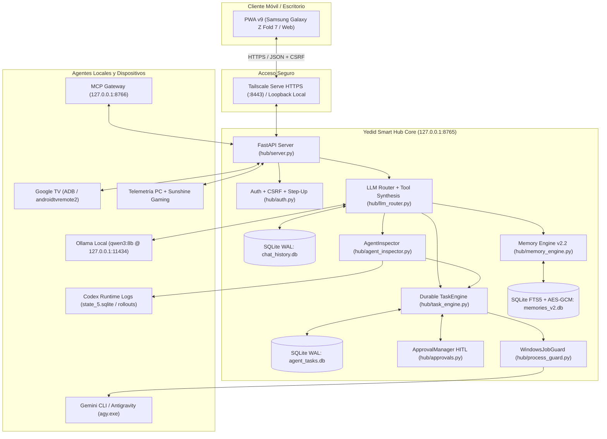

# Arquitectura del Sistema — Yedid Smart Hub v2.0

Este documento describe la arquitectura técnica de **Yedid Smart Hub v2.0**, sus límites de seguridad, el flujo de datos entre servicios y los motores transaccionales respaldados en SQLite.

---

## 1. Topología General de Servicios

---

## 2. Capas Principales de la Arquitectura

### 2.1 Capa de Presentación Progresiva (PWA v9)
- **Archivo principal:** `hub/static/index.html` junto con `hub/static/sw.js` y `hub/static/manifest.json`.
- **Diseño adaptable para Galaxy Z Fold 7:** Soporta modo **Pestañas** (óptimo en pantalla externa o plegada) y modo **Dashboard** (multipanel en pantalla interna desplegada).
- **Sincronización transaccional:**
  - El selector de conversaciones (`#select-conversation`) y su contador `(X msgs)` se sincronizan contra `/api/conversations` y `/api/conversations/{id}/messages` tras cada mensaje, cambio de pestaña y eventos de ciclo de vida (`visibilitychange`, `pageshow`).
  - Control de secuencia (`_loadMessagesSeq`) para evitar condiciones de carrera al alternar pestañas rápidamente.

### 2.2 Enrutador Conversacional y Orquestación Multiagente (`hub/llm_router.py`)
- **Persistencia e Idempotencia:** Cada mensaje del usuario incluye un `client_message_id` único para evitar duplicados ante reintentos de red móvil. Tanto el mensaje del usuario como la respuesta del asistente (incluyendo `tools_called` y `task_id`) se almacenan transaccionalmente en `chat_history.db`.
- **Detección determinista de intenciones multiagente:**
  - `agents_overview` / `gemini_status` / `quota_check`: Recolecta telemetría real en disco (`agent_inspector.inspect_codex_status()`, `inspect_gemini_status()`, `task_engine.list_tasks()`, `approval_manager.get_pending()`).
  - `handover_or_resume`: Localiza tareas interrumpidas por límite de cuota en Codex (`usage_limit_exceeded`), limpia rutas extendidas de Windows (`\\?\`), inspecciona los archivos existentes en el directorio del proyecto y registra una tarea duradera real en `task_engine` (`agent_tasks.db`).
  - `direct_task_execution`: Crea una tarea duradera directamente en `task_engine` vinculada a la conversación activa.
- **Prevención de respuestas vacías (`think: False` + Síntesis de Respaldo):**
  - Los payloads hacia Ollama (`qwen3:8b`) desactivan el vaciado de presupuesto de tokens en bloques ocultos (`"think": False`, `num_predict: 700`).
  - Si el modelo local devuelve una respuesta vacía o incompleta tras ejecutar herramientas, `_synthesize_tool_results_fallback()` genera determinísticamente un reporte estructurado en español con todos los estados, rutas, entregables y aprobaciones reales.

### 2.3 Motor Duradero de Tareas (`hub/task_engine.py` + `agent_tasks.db`)
- **Ciclo de vida de estados:** `queued` → `waiting_approval` (si `risk_level == 'HIGH'`) → `running` → `completed` | `failed` | `interrupted` | `cancelled`.
- **Ejecución desacoplada del navegador:** Un bucle de trabajo asíncrono (`_worker_loop`) procesa la cola en segundo plano en el servidor aunque el usuario cierre la PWA en el teléfono.
- **Reconciliación en arranque (`reconcile_on_startup`):** Al iniciar el Hub, cualquier tarea que hubiera quedado en `running` se marca limpiamente como `interrupted` (lista para reanudación inteligente con `resume_task()`) y se limpian únicamente procesos headless huérfanos cuyo proceso padre ya no exista.
- **Evidencia verificable en disco:** Al finalizar una tarea, `scan_deliverables()` registra los archivos creados/modificados dentro del directorio autorizado y publica un mensaje de resumen en la conversación vinculada.

### 2.4 Seguridad, Aislamiento de Procesos y Human-in-the-Loop (`HITL`)
1. **Política de Rutas (`hub/security_policy.py`):**
   - **Lista Blanca (`ALLOWED_PROJECT_ROOTS`):** Solo se permite operar dentro de `C:\Yedid-Smart-Home\sandbox`, `%USERPROFILE%\Documents\Codex`, `%USERPROFILE%\workspace` y `C:\Yedid-Smart-Home`.
   - **Zonas Rojas Prohibidas (`FORBIDDEN_EXACT_OR_PREFIX`):** Bloqueo estricto de `memories_v2.db`, `.token`, `backups/`, `C:\Windows`, `Program Files`, `.ssh`, `.aws`, `.gnupg`.
   - **Clasificación Determinista de Riesgo:** Cualquier tarea fuera de `sandbox` o que contenga verbos de modificación/sistema se clasifica automáticamente como `HIGH` (inmune a *prompt injection*).
2. **Aprobaciones Criptográficas (`hub/approvals.py`):**
   - Cada solicitud `HIGH` genera un registro con un `params_hash` SHA-256 canónico sobre `{task_id, agent, instruction, project_path, instruction_hash, allowed_project_path}`.
   - Expone en primer nivel **Tarea (`task_id`)**, **Agente (`agent`)**, **Alcance (`scope`)** y **Riesgo (`risk_level` / `risk_label`)**.
   - El token es de **un solo uso (`CONSUMED`)** y expira a los 10 minutos (`600s`). Si cualquier parámetro cambia entre la aprobación y la ejecución, `is_action_authorized()` aborta la tarea.
3. **Guardia de Procesos en Kernel (`hub/process_guard.py`):**
   - Asocia cada subproceso de agente (`agy.exe` o `python.exe`) a un **Windows Job Object** con `JOB_OBJECT_LIMIT_KILL_ON_JOB_CLOSE`, garantizando la terminación inmediata de todo el árbol de procesos ante cancelación o timeout.

### 2.5 Motor de Memoria Personal v2.2 (`hub/memory_engine.py`, `memory_db.py`, `memory_crypto.py`)
- Separado físicamente del historial de chat (`chat_history.db`).
- Almacena recuerdos estructurados en `memories_v2.db` con índice de búsqueda de texto completo **SQLite FTS5** y cifrado autenticado cuya clave maestra está protegida por **Windows DPAPI (`CryptProtectData`)** vinculada a la cuenta local de Windows.
- Soporta niveles de sensibilidad (`normal`, `personal`, `sensitive` con autenticación *Step-Up*) y flujo de propuestas en el chat (`propose_memory_to_save`).
