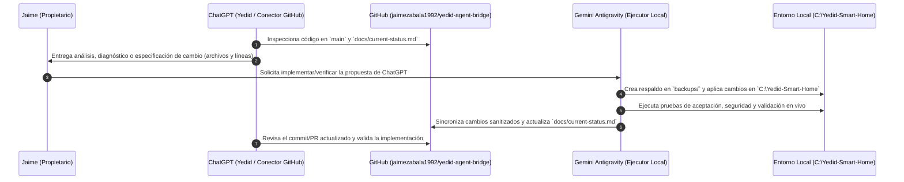

# Guía de Desarrollo y Protocolo de Colaboración Multi-Asistente

Este documento establece las instrucciones de desarrollo local y el **flujo oficial de trabajo colaborativo** entre **Gemini Antigravity**, **GitHub (`jaimezabala1992/yedid-agent-bridge`)** y **ChatGPT (Yedid)**.

---

## 1. Arquitectura de Dos Espacios de Trabajo (Producción vs. Puente GitHub)

Para proteger la instalación funcional en todo momento y evitar la exposición accidental de datos locales, el desarrollo opera sobre dos directorios claramente separados:

1. **Entorno Productivo Local (`C:\Yedid-Smart-Home`):**
   - Ejecuta los servicios en vivo (`hub.server:app` en `:8765` y `mcp_gateway.server:gateway_app` en `:8766`).
   - Contiene las bases de datos SQLite reales (`data/chat_history.db`, `data/agent_tasks.db`, `data/memories_v2.db`), tokens (`.token`), certificados de TV (`.tvremote/`) y puntos de restauración (`backups/`).
   - **Nunca se conecta directamente como repositorio público a GitHub.**

2. **Copia de Trabajo Sanitizada para GitHub (`%USERPROFILE%\workspace\yedid-agent-bridge`):**
   - Clon/espacio Git independiente vinculado a `https://github.com/jaimezabala1992/yedid-agent-bridge.git` (rama `main`).
   - Contiene únicamente código fuente sanitizado, scripts portables y documentación técnica (`README.md`, `docs/*`).
   - Auditado automáticamente por `scripts/github_sync.py --audit` antes de cualquier commit o push.

---

## 2. Configuración del Entorno Local

### Requisitos
- **Sistema Operativo:** Windows 10/11 (x64)
- **Python:** 3.12+
- **Ollama Local:** Modelo `qwen3:8b` (`ollama pull qwen3:8b`) escuchando en `http://127.0.0.1:11434`
- **Antigravity / Gemini CLI:** Binario `agy.exe` (`v1.4.2+`)

### Instalación de dependencias
```powershell
pip install -r requirements.txt
```

### Variables de Entorno
Copia `.env.example` a `.env` en tu entorno local si deseas personalizar puertos, rutas o el dominio de Tailscale:
```powershell
Copy-Item .env.example .env
```

### Ejecución de Servicios
- **Yedid Hub Core (`127.0.0.1:8765`):**
  ```powershell
  python -m uvicorn hub.server:app --host 127.0.0.1 --port 8765
  ```
- **Yedid MCP Gateway (`127.0.0.1:8766`):**
  ```powershell
  python -m uvicorn mcp_gateway.server:gateway_app --host 127.0.0.1 --port 8766
  ```

---

## 3. Flujo de Colaboración: Gemini Antigravity ↔ GitHub ↔ ChatGPT (Yedid)



### 3.1 Roles de cada asistente

| Participante | Responsabilidades Principales |
| :--- | :--- |
| **ChatGPT (Yedid)** | • Consultar el repositorio `jaimezabala1992/yedid-agent-bridge` mediante el conector oficial de GitHub.<br>• Revisar la arquitectura, detectar bugs lógicos o condiciones de carrera y proponer mejoras.<br>• Redactar especificaciones técnicas precisas indicando archivo, función y criterios de aceptación.<br>• Revisar los commits y el estado reportado en `docs/current-status.md` tras cada iteración. |
| **Gemini Antigravity** | • Crear puntos de restauración locales antes de modificar `C:\Yedid-Smart-Home`.<br>• Implementar los cambios en el código local, ejecutar pruebas reales contra SQLite/Ollama/FastAPI y verificar que ningún servicio se degrade.<br>• Sincronizar el código hacia la copia de trabajo `%USERPROFILE%\workspace\yedid-agent-bridge` aplicando la sanitización automática.<br>• Actualizar `docs/current-status.md` con la evidencia de las pruebas y preparar el commit/push previa autorización de Jaime. |
| **GitHub (`yedid-agent-bridge`)** | • Mantener el historial limpio de versiones, ramas de funcionalidades y documentación viva del proyecto. |

---

## 4. Convenciones de Ramas, Commits y Pull Requests

### 4.1 Estrategia de Ramas
- **`main`:** Rama principal estable. Refleja siempre la versión validada y en ejecución en el entorno local de Jaime.
- **`feat/<nombre-corto>`:** Nuevas funcionalidades o mejoras arquitectónicas en evaluación (ej. `feat/multiagent-telemetry`).
- **`fix/<nombre-corto>`:** Correcciones quirúrgicas de fallos detectados en el Galaxy Fold 7 o en el backend (ej. `fix/fold7-chat-sync`).
- **`docs/<nombre-corto>`:** Actualizaciones de arquitectura, auditorías o reportes de estado para revisión de ChatGPT.

### 4.2 Formato de Mensajes de Commit
Utilizamos *Conventional Commits* en español o inglés claro para que ChatGPT identifique de inmediato el propósito de cada cambio:
- `fix(router): evitar respuestas vacías en qwen3 tras llamadas a herramientas`
- `fix(pwa): sincronizar selector y contador de conversaciones con SQLite`
- `feat(approvals): exponer tarea, alcance y riesgo explícitamente en HITL`
- `docs(status): actualizar estado tras validación en Galaxy Fold 7`

### 4.3 Cómo intercambiar revisiones con ChatGPT
1. **Para pedir a ChatGPT que revise el estado actual:**
   Indícale a ChatGPT:
   > *"Revisa en el repositorio `jaimezabala1992/yedid-agent-bridge` (rama `main`) el archivo `docs/current-status.md` y los módulos `hub/llm_router.py`, `hub/task_engine.py`, `hub/approvals.py` y `hub/static/index.html`."*
2. **Para pasar una propuesta de ChatGPT a Gemini Antigravity:**
   Comparte con Gemini las observaciones o el bloque propuesto por ChatGPT. Gemini lo aplicará en `C:\Yedid-Smart-Home`, correrá las pruebas locales, actualizará `docs/current-status.md` y sincronizará el nuevo commit hacia GitHub.

---

## 5. Uso del Script de Sincronización Segura (`scripts/github_sync.py`)

El repositorio cuenta con la utilidad `scripts/github_sync.py` que automatiza la sincronización entre `C:\Yedid-Smart-Home` y `%USERPROFILE%\workspace\yedid-agent-bridge` aplicando una **barrera de seguridad pre-push**:

```powershell
# 1. Sincronizar archivos desde C:\Yedid-Smart-Home, sanitizar y ejecutar auditoría de seguridad
python scripts/github_sync.py --sync-and-audit

# 2. Ver resumen de archivos listos para publicar y estado del árbol Git
python scripts/github_sync.py --status

# 3. Publicar hacia GitHub (requiere autorización de Jaime y token de GitHub configurado)
python scripts/github_sync.py --push -m "Descripción del commit"
```

Si el escáner detecta cualquier patrón prohibido (correos personales, dominios `.ts.net` reales, IPs privadas `10.0.0.*`, rutas `C:\Users\<usuario>`, tokens o archivos `.db`/`.pem`), **aborta automáticamente** antes de crear el commit o realizar el push.
